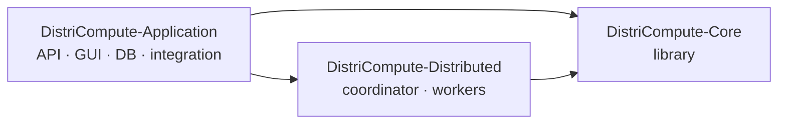
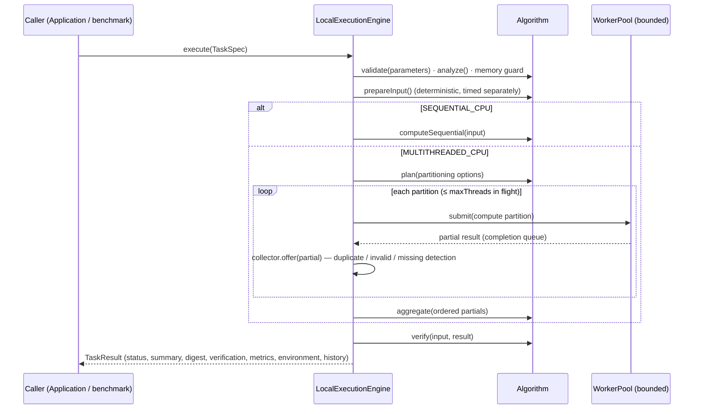

# DistriCompute-Core — Architecture

| | |
|---|---|
| Component | DistriCompute-Core (Contributor 1: computational algorithms and execution primitives) |
| Repository | `meubaidkaleem-glitch/PDC-Project` (acts as DistriCompute-Core, see [§2.1](#21-repository-naming)) |
| Document status | Draft — Phase 1 architecture review, updated as phases complete |
| Related | [implementation-plan.md](implementation-plan.md), [integration-contract.md](integration-contract.md) |

---

## 1. Purpose

DistriCompute is an adaptive heterogeneous platform for parallel and distributed computation that also
analyses performance. Core is its computational foundation. It is a **plain Java 21 library** with no
Spring, database, UI or network dependency. It provides:

* a universal task model, task lifecycle and error model shared by all three repositories;
* an algorithm abstraction (SPI) and an algorithm registry used for discovery;
* deterministic input generation, input validation, workload analysis and memory estimation;
* sequential reference implementations and bounded local multithreaded execution;
* partitioning, partial-result collection (duplicate, missing and invalid detection), aggregation and
  result verification, plus explicit serialization formats so that the distributed runtime can ship
  partitions to remote workers;
* execution metrics, environment capture and a reproducible benchmark framework;
* a strategy assessment interface, and an optional GPU backend abstraction that is capability-detected and
  never assumed.

Core does **not** implement networking, worker registration, cluster resource discovery, remote scheduling,
failure recovery, persistence, REST APIs or the GUI. See [§4](#4-responsibilities-and-non-duplication).

---

## 2. Initial repository assessment (Phase 1 review, 2026-11-19)

| Item | Finding |
|---|---|
| Commits | One commit, `bf0a6c1` "Initial commit". |
| Files | `README.md` containing only `# PDC-Project`. |
| Branches | `main` only. Phase 1 created `feature/core-engine` from `main`. |
| Source code, build files, dependencies | None. |
| Tests, CI, license | None. |
| Shared contracts | None found. The DistriCompute-Distributed and DistriCompute-Application repositories were not accessible from this account during the review, so no agreed contract document exists to reference. |
| Toolchain verified | OpenJDK 21.0.13 and Apache Maven 3.9.11; Maven Central was reachable. |

**Conclusion:** nothing is implemented, so there is no working code to preserve. Everything in this
repository is new. All interface definitions are **proposals (contract v0.x)** until Contributors 2 and 3
review them. The shared rules require the agreed contract to live in the Application repository. Once that
repository exists, the agreed version of [integration-contract.md](integration-contract.md) should move
there, and this repository should reference it.

### 2.1 Repository naming

The shared specification names this repository `DistriCompute-Core`, but the GitHub repository is named
`PDC-Project`. This matters because the Application repository pins Core as a Git submodule by URL.
Recommendation: rename the GitHub repository to `DistriCompute-Core` before the Application adds the
submodule. GitHub redirects the old URL, but `.gitmodules` should use the final name. The Maven coordinates
already use the project name: `org.districompute:districompute-core`.

---

## 3. Lifecycle stage ownership

The shared rules define a 15-stage end-to-end lifecycle. The table shows which stages Core implements and
which stages Core only supports with information.

| # | Stage | Owner | Core's contribution |
|---|---|---|---|
| 1 | User submission | Application | `TaskSpec` model and JSON format |
| 2 | Input validation | Application (request shape) + **Core** (semantic) | Parameter schema validation, cross-field and dimension checks, memory guard |
| 3 | Algorithm discovery | **Core** (registry), exposed by Application | `AlgorithmRegistry`, `AlgorithmDescriptor` catalog |
| 4 | Workload analysis | **Core** | `WorkloadProfile`: dimensions, operation and memory estimates, parallelizability, communication volume |
| 5 | Resource discovery | Distributed (cluster), **Core** (local node only) | `LocalResourceProbe` for the local node; Core never invents remote workers |
| 6 | Execution recommendation | **Core** (assessment) + Application (history) | `StrategyAdvisor` evaluates modes against a supplied resource snapshot and optional history |
| 7 | Strategy selection | Application (user decision) | Explicit "unsupported" and "unsuitable" verdicts |
| 8 | Task partitioning | **Core** | Deterministic range, chunk and block partition plans |
| 9 | Execution | **Core** (sequential, local parallel), Distributed (remote) | Kernels, bounded worker pool, worker-side partition execution |
| 10 | Progress monitoring | Core emits, Distributed relays, Application displays | `ProgressEvent` model, throttled and monotonic |
| 11 | Result aggregation | **Core** | `PartialResultCollector` and per-algorithm aggregation |
| 12 | Result validation | **Core** | Per-algorithm verifiers and tolerance rules |
| 13 | Metrics recording | Core measures, Application persists | `ExecutionMetrics` with defined units |
| 14 | Experiment storage | Application | — |
| 15 | Report generation | Application | Benchmark report data (statistics, environment) |

---

## 4. Responsibilities and non-duplication

| Concern | Core | Distributed (C2) | Application (C3) |
|---|---|---|---|
| Algorithms, kernels, verification | **owns** | uses | uses |
| Task model, lifecycle, error model (Java binding) | **owns** (proposal) | uses | uses, persists |
| Partition planning, payload codecs, aggregation | **owns** | transports and dispatches | — |
| Local multithreaded execution | **owns** | uses on workers | uses for local runs |
| Worker registration, heartbeats, cluster resources | — | **owns** | displays |
| Remote scheduling, failure detection, retries | — | **owns** (uses Core's retry eligibility) | displays |
| Strategy assessment (cost model) | **owns** the interface and model | supplies the resource snapshot | supplies history, shows the choice |
| Benchmark harness and statistics | **owns** (local) | adds communication metrics | stores and reports |
| REST API, GUI, database, reports | — | — | **owns** |

Points of possible overlap, and how this design avoids them:

* **Local resource information.** Core probes only the node it runs on (cores, heap, OS, JVM) because the
  local engine needs it. Distributed may reuse `LocalResourceProbe` when a worker registers. It should not
  re-implement it.
* **Statistics.** Core computes benchmark statistics from raw samples. The Application should store the raw
  samples and reuse Core's `SampleStatistics` rather than write a second implementation.
* **Lifecycle state machine.** Core defines the states and permitted transitions, and enforces them in local
  execution. The Application and Distributed track the persistent and remote state with the same
  definitions.

---

## 5. Dependencies between repositories

* **Core depends on no other DistriCompute repository.** Its runtime dependencies are Jackson (JSON),
  SLF4J (logging API only) and the JDK.
* **Distributed → Core.** Workers execute Core partitions. The coordinator uses Core for partition plans,
  payload codecs, the partial-result collector, aggregation and verification.
* **Application → Core.** It uses the algorithm catalog, validation, workload profiles, local execution,
  strategy assessment and benchmark data.
* **Build integration (needs a team decision).** The Application's aggregator build compiles the pinned Core
  and Distributed submodules from source, which keeps it reproducible from a clean checkout. Distributed
  must also build independently, so it needs a published Core artifact. The options are:
  1. *(recommended)* Core tags releases (`v0.1.0`, …) and Distributed's CI checks out the pinned tag and runs
     `mvn install` before its own build. This needs no credentials and nothing is copied.
  2. JitPack builds the tag on demand. This adds a third-party build service.
  3. GitHub Packages. Every consumer then needs a token to read packages, which adds friction for the team
     and for markers.

---

## 6. Architecture overview

### 6.1 Package structure

The library is a **single Maven module** with one package per concern, following the structure the project
brief proposed. One module keeps consumption simple: Distributed and Application each add a single
dependency.

| Package | Responsibility |
|---|---|
| `org.districompute.core` | Cross-cutting types: `CoreVersion`, error model (`ErrorCode`, `ErrorInfo`, `DistriComputeException`) |
| `…core.task` | `TaskSpec`, `TaskStatus` and the lifecycle state machine, constraints, priority |
| `…core.algorithm` | The algorithm SPI, descriptors, identifiers, versions and parameter schema |
| `…core.algorithm.<family>` | Algorithm implementations (`primes`, `sort`, `matrix`, `numeric`, `data`) |
| `…core.registry` | Algorithm discovery (`ServiceLoader` and explicit registration) |
| `…core.validation` | Parameter validation, violations, verification reports and tolerance rules |
| `…core.execution` | Execution modes, context, cancellation, progress, bounded worker pool, local engine |
| `…core.partition` | Partition model and strategies (range, chunk, block) |
| `…core.result` | Partial and final results, `PartialResultCollector`, result digests |
| `…core.metrics` | Execution metrics, environment capture, statistics, benchmark framework |
| `…core.resource` | Local resource probe, resource snapshot model, GPU backend abstraction |
| `…core.scheduling` | Strategy assessment (`StrategyAdvisor`) |
| `…core.serialization` | JSON contract codec (Jackson) and binary payload codecs |

### 6.2 Key abstractions

* **`ComputeAlgorithm<I, R>`** is the SPI every algorithm implements. It covers the descriptor, semantic
  validation, workload analysis, deterministic input preparation, the sequential reference implementation
  and result verification.
* **`PartitionedAlgorithm<I, W, P, R>`** is the optional capability for partitioned execution: plan →
  extract work unit → compute partition → validate partial → aggregate, with codecs for `W` and `P`.
  Local multithreaded execution and distributed execution both use this one path, so the logic Distributed
  depends on is exercised by every local parallel test.
* **Supported modes are derived, not declared.** `SEQUENTIAL_CPU` is always available. `MULTITHREADED_CPU`
  and distributed compatibility exist only if the algorithm implements `PartitionedAlgorithm`. `GPU` exists
  only if a GPU backend is detected *and* supports the algorithm. An algorithm cannot advertise a mode it
  does not implement.
* **The local engine** runs the lifecycle locally: validate → analyse and check memory → plan → queue → run
  → aggregate → verify. Status changes go through the state machine. A task is `COMPLETED` only after
  aggregation and verification succeed.

### 6.3 Execution flow (local)

In distributed execution the loop in the middle runs across the network. Contributor 2's coordinator calls
the same plan → encode → (remote) decode → compute → encode → (coordinator) decode → collect → aggregate →
verify steps through the Core facade described in the integration contract.

### 6.4 Design decisions

| ID | Decision | Rationale |
|---|---|---|
| D1 | Single Maven module; packages per concern | Simple consumption; avoids splitting a library that is consumed whole |
| D2 | One partition/aggregate path for local parallel and distributed execution | The distributed logic is tested locally; overheads can be separated (distributed − local partitioned ≈ communication + remote scheduling) |
| D3 | The sequential baseline does not use the partition machinery | A valid speedup baseline with no partition overhead |
| D4 | Deterministic counter-based input generation with a documented formula | Reproducible inputs across runs, nodes and implementations; partition-invariant Monte Carlo |
| D5 | Same per-element accumulation order in every mode (e.g. matrix multiplication) | Java floating point is strict (JEP 306), so results are bitwise identical across modes, which gives an exact cross-mode check |
| D6 | Verification is mandatory for `COMPLETED` | The rule that completion requires validated aggregation; every P1 verifier is asymptotically cheaper than the computation or as cheap |
| D7 | JSON (Jackson) for contract envelopes; versioned little-endian binary for bulk numeric payloads; no Java object serialization | Explicit, language-neutral and safe formats |
| D8 | SLF4J API only; no logging binding shipped | Library best practice; the consuming application picks the backend |
| D9 | One bounded worker pool per engine, with a per-task concurrency limit and a completion queue | No unbounded thread creation; thread start-up excluded from measurements; controlled submission |
| D10 | GPU is an SPI plus capability detection; no GPU backend ships without real hardware validation | Honest capability reporting (rule: advertise only working implementations) |

---

## 7. Interfaces and data contracts

The full proposal, with JSON examples, is in [integration-contract.md](integration-contract.md). In summary:
task representation (`TaskSpec`), task status and transitions, algorithm identifiers and versions,
partition descriptor, partial result envelope and classification, final result (`TaskResult`), error model,
execution metrics, resource requirements (`WorkloadProfile`), cancellation semantics, progress events, and
the versioning policy.

---

## 8. Risks, complexity and limitations

| # | Risk | Impact | Mitigation |
|---|---|---|---|
| R1 | Contracts not yet agreed with Contributors 2 and 3 | Rework if the formats change | Publish the proposal early; version everything (`schemaVersion`); keep the contract surface small; don't build transport-specific code |
| R2 | Repository name differs from the specification | Wrong submodule URL | Rename the repository before integration ([§2.1](#21-repository-naming)) |
| R3 | Distributed needs a Core artifact for an independent build | Distributed CI can't build | Tagged releases plus CI `mvn install` of the pinned tag ([§5](#5-dependencies-between-repositories)) |
| R4 | No GPU in the dev or CI environment (GitHub-hosted runners have none) | A GPU backend can't be validated | Ship the SPI and detection only; document the integration path; never advertise GPU without a detected, validated backend |
| R5 | JVM benchmarking pitfalls: JIT warm-up, GC, frequency scaling, noisy CI, container CPU quotas | Misleading numbers | Warm-ups, repeated trials, median and dispersion, recorded environment; CI asserts correctness only, never timing |
| R6 | Memory exhaustion (e.g. three 8192² double matrices ≈ 1.5 GiB) | `OutOfMemoryError` mid-run | Estimate peak memory before allocating; reject with `RESOURCE_EXHAUSTED` |
| R7 | Floating-point differences if accumulation order changes (e.g. future SIMD, FMA or k-splitting) | False verification failures | Verifiers use error-bounded tolerances; bitwise checks apply only where the order is provably identical |
| R8 | Concurrency defects (races, leaked threads, lost exceptions) | Wrong results, hangs | Disjoint writes only; structured completion (no task outlives its call); dedicated concurrency test suite; executor shutdown tests |
| R9 | Communication cost in distributed matrix multiplication (B replicated per row band) | Distributed slower than local | 2-D block partitioning option; the profile reports the communication volume; no claim that distributed is always faster |
| R10 | Sequential aggregation steps (k-way merge in sorting) limit speedup | Speedup ceiling (Amdahl) | Measure aggregation separately; document; consider a parallel merge later |
| R11 | Breadth of scope (5 modes, about 12 operations, benchmark framework) | Shallow, untested features | Strict phase order; P1 algorithms first; each phase ends green; postponed items listed explicitly |
| R12 | Contribution integrity (AI-assisted work in a graded team project) | Policy risk for the contributor | Commits carry a `Co-Authored-By` trailer; the contributor reviews all work and confirms the course policy allows AI assistance |

---

## 9. Postponed features

See [implementation-plan.md §4](implementation-plan.md#4-postponed-features). In short: a real GPU backend,
hybrid execution, dataset upload and references, Strassen and other numerically different matrix
algorithms, dynamic (work-stealing) partition generation across nodes, priority 3 algorithms, and anything
that belongs to Distributed or Application.
