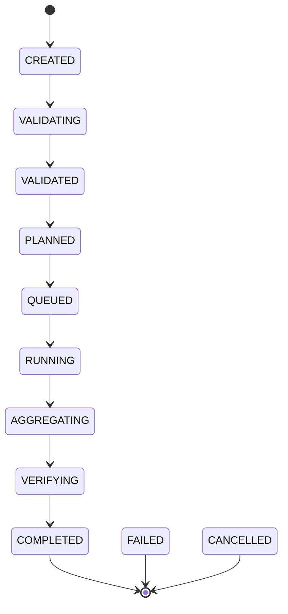

# DistriCompute Integration Contract — Core proposal

| | |
|---|---|
| Contract schema version | `0.1` (**draft**: any field may change until the three contributors agree on `1.0`) |
| Proposed by | Contributor 1 (DistriCompute-Core) |
| Must be reviewed by | Contributor 2 (Distributed), Contributor 3 (Application) |
| Final home | `DistriCompute-Application/docs/contracts/` (shared rule 2); this file then becomes a reference |

This document proposes the shared data contracts that Core produces or consumes. The Java types live in
`org.districompute.core.*` and serialize to the JSON shown here through Core's JSON codec (Jackson). Java
object serialization is **never** used across process boundaries.

> **Status markers.** Each section says whether Core implements it yet. The marker reflects the code on this
> branch, not plans.

---

## 1. Conventions

* JSON field names use `lowerCamelCase`. Enum values use `UPPER_SNAKE_CASE`.
* Timestamps are ISO-8601 UTC instants (`2026-11-19T10:15:30.123Z`). Durations are integer **nanoseconds**
  in fields named `…Nanos`, or integer milliseconds in fields named `…Millis`.
* Sizes are integer **bytes** in fields named `…Bytes`.
* Every top-level contract object carries `schemaVersion` (see [§12](#12-versioning-policy)).
* Optional fields may be omitted or set to `null`. Readers **must ignore unknown fields** within the same
  schema major version. While the major version is `0` (draft), readers also reject a different minor
  version.

---

## 2. Task representation — `TaskSpec`  *(Core: implemented — `org.districompute.core.task.TaskSpec`)*

A task is an immutable request to run one algorithm on one input.

```json
{
  "schemaVersion": "0.1",
  "taskId": "8b0e3d1c-5a52-4f87-9b8e-2b1f0c7e6a10",
  "experimentId": "exp-matmul-scaling",
  "algorithm": { "id": "matrix.multiply", "version": "1.0.0" },
  "parameters": { "rowsA": 1024, "colsA": 1024, "colsB": 1024, "seed": 42, "distribution": "UNIFORM" },
  "constraints": {
    "mode": "MULTITHREADED_CPU",
    "maxThreads": 4,
    "partitioning": { "targetPartitions": 16 },
    "timeoutMillis": 600000,
    "maxMemoryBytes": null
  },
  "priority": "NORMAL",
  "createdAt": "2026-11-19T10:15:30Z"
}
```

| Field | Type | Rules |
|---|---|---|
| `taskId` | string | Required. 1–128 characters from `[A-Za-z0-9._:-]`. Unique per platform (the Application generates it, typically a UUID). |
| `experimentId` | string | Optional. Same character rules. Groups repeated runs. |
| `algorithm.id` | string | Required. See [§4](#4-algorithm-identifiers-and-versions). |
| `algorithm.version` | string | Optional in requests (it resolves to the registered version). Always present in results. |
| `parameters` | object | Algorithm-specific. Validated against the algorithm's parameter schema from the catalog. **Input representation**: generated inputs are described by parameters (sizes, `seed`, `distribution`); small inline inputs use array parameters. |
| `constraints.mode` | enum | `SEQUENTIAL_CPU`, `MULTITHREADED_CPU`, `DISTRIBUTED_CPU`, `GPU`, `HYBRID`. A mode that the algorithm or the executing component doesn't support is rejected with `UNSUPPORTED_EXECUTION_MODE`. |
| `constraints.maxThreads` | int ≥ 1 | Thread count for `MULTITHREADED_CPU`. Defaults to the available processors. |
| `constraints.partitioning` | object | Optional: `targetPartitions`, `partitionSize`, `blockRows`, `blockCols`. Which fields apply depends on the algorithm's partition strategy. |
| `constraints.timeoutMillis` | int ≥ 1 | Optional deadline for the whole execution. Exceeding it fails the task with `TIMEOUT`. |
| `constraints.maxMemoryBytes` | int ≥ 1 | Optional cap. The memory guard uses `min(cap, available heap)`. |
| `priority` | enum | `LOW`, `NORMAL` (default), `HIGH`. A scheduling hint for queues; Core's local engine does not reorder. |
| `createdAt` | instant | Required. |

The runtime state that accompanies a task (status, validation result, workload profile and status history)
is reported in `TaskResult` ([§8](#8-final-result--taskresult)) and in progress events ([§11](#11-progress-events)).

---

## 3. Task status and permitted transitions  *(Core: implemented — `TaskStatus`, `TaskLifecycle`)*



| Status | Meaning |
|---|---|
| `CREATED` | Accepted, not yet examined. |
| `VALIDATING` / `VALIDATED` | Parameter schema, cross-field, dimension and memory checks are running / have passed. |
| `PLANNED` | Mode, thread count and partition plan are fixed. |
| `QUEUED` | Waiting for execution capacity. |
| `RUNNING` | Partitions are executing (or the sequential implementation is running). |
| `AGGREGATING` | Every partial result is present and valid; the final result is being assembled. |
| `VERIFYING` | The assembled result is being verified independently. |
| `COMPLETED` | Terminal. **Only reachable from `VERIFYING` after verification passes.** A stopped thread never means completion. |
| `FAILED` | Terminal. Reachable from any non-terminal status. Carries an `ErrorInfo`. |
| `CANCELLED` | Terminal. Reachable from any non-terminal status after a cancellation request. |

Any other transition is rejected with `INVALID_STATE_TRANSITION`. Terminal states are final: a retry is a new
execution attempt with its own status history.

---

## 4. Algorithm identifiers and versions  *(Core: implemented — `AlgorithmId`, `AlgorithmVersion`, `AlgorithmRegistry`)*

* **Identifier.** Lowercase, dot-separated `family.operation`, matching
  `^[a-z][a-z0-9]*(\.[a-z][a-z0-9-]*)+$`. Identifiers are permanent and never reused for a different
  computation.

  | Id | Workload | Priority |
  |---|---|---|
  | `primes.count` | Count primes in `[lowerBound, upperBound]` | P1 |
  | `sort.merge` | Merge sort of 64-bit integers | P1 |
  | `matrix.add` | Dense matrix addition | P1 |
  | `matrix.multiply` | Dense matrix multiplication | P1 (main demonstration) |
  | `numeric.integrate`, `numeric.polynomial-eval`, `numeric.root-find`, `numeric.monte-carlo` | Numerical operations | P2 |
  | `data.filter` (search and filter), `data.statistics` | Data processing | P2 |

* **Version.** Semantic version `MAJOR.MINOR.PATCH` of the *algorithm contract*: its parameters, result
  semantics and partition payload format. This is independent of the Core release version.
  * MAJOR: an incompatible change to parameters, results or the payload format.
  * MINOR: a backward-compatible addition, such as a new optional parameter.
  * PATCH: an implementation change with an identical contract, such as a performance fix.
  * **Compatibility rule:** a request for `x.y.z` is satisfied by a registered `x.y'.z'` with the same MAJOR
    and `y' ≥ y`. A coordinator and its workers must run the same MAJOR.MINOR.

The catalog entry (`AlgorithmDescriptor` plus derived capabilities) lists the display name, description,
category, parameter schema (name, type, required, default, min, max, allowed values, unit), result type,
verification method, limitations, **supported modes**, partition strategy and GPU compatibility. Supported
modes are derived from the interfaces the implementation actually provides. They are never hand-declared.

---

## 5. Resource requirement model — `WorkloadProfile`  *(Core: implemented for P1 algorithms; plan-dependent communication fields in Phase 5)*

Produced from parameters alone, without allocating the input.

```json
{
  "algorithm": { "id": "matrix.multiply", "version": "1.0.0" },
  "dimensions": { "rowsA": 1024, "colsA": 1024, "colsB": 1024 },
  "estimatedOperations": 2147483648,
  "operationUnit": "floating-point operations",
  "timeComplexity": "O(m·k·n)",
  "inputBytes": 16777216,
  "outputBytes": 8388608,
  "estimatedPeakMemoryBytes": 25165824,
  "parallelism": {
    "partitionable": true,
    "partitionStrategy": "BLOCK_2D",
    "maxUsefulPartitions": 1048576,
    "dataDependency": "NONE",
    "aggregation": "Copy blocks into the result matrix, O(m·n)"
  }
}
```

The fields Contributor 2's scheduler needs that depend on a concrete partition plan (bytes sent to workers,
bytes returned, partition-count limits) are defined in Phase 5. They'll be calculated exactly from the plan,
not guessed.

---

## 6. Partition representation  *(Core: implemented — `PartitionDescriptor`, `PartitionBounds`, `Partitioners`, payload codecs)*

```json
{
  "schemaVersion": "0.1",
  "partitionId": "8b0e3d1c-5a52-4f87-9b8e-2b1f0c7e6a10/p3",
  "taskId": "8b0e3d1c-5a52-4f87-9b8e-2b1f0c7e6a10",
  "algorithm": { "id": "matrix.multiply", "version": "1.0.0" },
  "index": 3,
  "count": 16,
  "bounds": { "type": "BLOCK", "rowStart": 256, "rowEnd": 512, "colStart": 0, "colEnd": 1024 },
  "resultType": "matrix-block",
  "retryable": true
}
```

* `partitionId` = `<taskId>/p<index>`. It is deterministic, so a regenerated plan yields the same ids.
* `bounds.type` is one of `RANGE` (`start`, `endExclusive`), `CHUNK` (`offset`, `length`) or `BLOCK` (row and
  column ranges, end-exclusive).
* Plans are deterministic for a given input and options. Partitions cover the input exactly once, with no
  gaps and no overlaps, and this is checked on construction.
* `retryable` is true when computing the partition is deterministic and free of side effects, which makes it
  eligible for re-execution after a worker failure.
* The **work-unit payload** (the data a worker needs) travels as a versioned binary payload in a
  little-endian layout with a CRC-32C checksum. In JSON it is base64-encoded:
  `{ "format": "…/1", "sizeBytes": n, "crc32c": "…", "base64": "…" }`. The transport may send the bytes
  out-of-band instead.
* Runtime partition status: `PENDING`, `RUNNING`, `COMPLETED`, `FAILED`, `CANCELLED`, plus execution metadata
  (attempt, worker id, timings). The distributed runtime may add dispatch states of its own.

---

## 7. Partial results  *(Core: implemented — `PartialResultMessage`, `PartialResultCollector`)*

```json
{
  "schemaVersion": "0.1",
  "taskId": "8b0e3d1c-5a52-4f87-9b8e-2b1f0c7e6a10",
  "partitionId": "8b0e3d1c-5a52-4f87-9b8e-2b1f0c7e6a10/p3",
  "index": 3,
  "attempt": 1,
  "resultType": "matrix-block",
  "payload": { "format": "matrix-f64-le/1", "sizeBytes": 2097176, "crc32c": "1c2d3e4f", "base64": "…" },
  "computeNanos": 123456789,
  "workerId": "worker-2"
}
```

When a partial result arrives, Core's `PartialResultCollector` classifies it as:

| Classification | Meaning | Effect |
|---|---|---|
| `ACCEPTED` | Valid and the first result for this index | Stored |
| `DUPLICATE` | A valid result already exists, and this one is identical by digest | Ignored and counted |
| `CONFLICTING_DUPLICATE` | A valid result already exists, but this one differs | Rejected and reported (indicates a faulty worker) |
| `INVALID` | Wrong task, type, dimensions or bounds, a checksum mismatch or a decode error | Rejected; the partition stays incomplete |
| `UNKNOWN_PARTITION` | The index or id is not in the plan | Rejected |
| `LATE` | The task is already terminal | Ignored |

Failures are reported explicitly (`markFailed(index, ErrorInfo)`). Aggregation is refused while any partition
is **missing** or **failed**, and the error lists those indices. Invalid or missing results are never
silently dropped.

---

## 8. Final result — `TaskResult`  *(Core: implemented — `TaskResult`, produced by `LocalExecutionEngine`)*

```json
{
  "schemaVersion": "0.1",
  "taskId": "8b0e3d1c-5a52-4f87-9b8e-2b1f0c7e6a10",
  "experimentId": "exp-matmul-scaling",
  "algorithm": { "id": "matrix.multiply", "version": "1.0.0" },
  "status": "COMPLETED",
  "mode": "MULTITHREADED_CPU",
  "threads": 4,
  "partitions": 16,
  "result": { "type": "matrix", "digest": "sha256:…", "summary": { "rows": 1024, "cols": 1024 } },
  "verification": { "method": "…", "kind": "PROBABILISTIC", "passed": true, "details": { } },
  "profile": { },
  "metrics": { },
  "environment": { },
  "statusHistory": [ { "status": "CREATED", "at": "…" } ],
  "error": null
}
```

* `result.digest` is the SHA-256 of the result's canonical binary encoding. Equal digests across modes
  (sequential, multithreaded or distributed) mean bitwise-identical results.
* Large results (matrices, sorted arrays) are summarized. The full value is available to in-process callers
  through the Java API and can be encoded with the payload codecs.

---

## 9. Error model — `ErrorInfo`  *(Core: implemented — `ErrorCode`, `ErrorInfo`, `DistriComputeException`)*

```json
{
  "code": "VALIDATION_FAILED",
  "message": "colsA (512) must equal the number of rows of B (256)",
  "retryable": false,
  "status": "VALIDATING",
  "partitionIndex": null,
  "violations": [ { "field": "colsA", "code": "DIMENSION_MISMATCH", "message": "…" } ]
}
```

`status` is the task status in which the error happened. `retryable` means re-executing the *same* request
could plausibly succeed, so the work is eligible for automatic recovery.

| Code | Retryable | Typical cause |
|---|---|---|
| `VALIDATION_FAILED` | no | Bad parameters or dimensions |
| `UNKNOWN_ALGORITHM` | no | Id not registered |
| `UNSUPPORTED_ALGORITHM_VERSION` | no | No compatible version registered |
| `UNSUPPORTED_EXECUTION_MODE` | no | Mode not implemented for the algorithm or component |
| `UNSUPPORTED_SCHEMA_VERSION` | no | Contract version mismatch |
| `RESOURCE_EXHAUSTED` | no | Memory estimate exceeds the available budget |
| `INVALID_STATE_TRANSITION` | no | Programming error in a lifecycle driver |
| `PARTITION_FAILED` | yes | A partition threw an exception |
| `INVALID_PARTIAL_RESULT` | yes | A partial result failed validation |
| `MISSING_PARTIAL_RESULT` | yes | Aggregation requested with partitions missing |
| `AGGREGATION_FAILED` | no | Inconsistent partial results |
| `VERIFICATION_FAILED` | yes | The final result failed independent verification |
| `SERIALIZATION_FAILED` | yes | A payload decode or checksum failure |
| `TIMEOUT` | yes | Deadline exceeded |
| `CANCELLED` | no | Cancellation requested |
| `EXECUTION_FAILED` | yes | Unexpected exception |
| `INTERNAL_ERROR` | no | Bug in Core |

---

## 10. Execution metrics  *(Core: implemented — `ExecutionMetrics`; multithreaded fields filled from Phase 4)*

All durations are wall-clock nanoseconds measured with `System.nanoTime()` on the executing node, unless the
definition says otherwise.

| Field | Definition |
|---|---|
| `inputPreparationNanos` | Generating or decoding the input. Excluded from `executionNanos`. |
| `partitioningNanos` | Building the partition plan and extracting work units. |
| `computeNanos` | From the first partition submission to the last partial result collected (sequential: the reference implementation). |
| `aggregationNanos` | Collecting, ordering and assembling partial results. |
| `executionNanos` | `partitioning + compute + aggregation`, measured as one interval. **The basis for speedup.** |
| `verificationNanos` | Independent verification. Excluded from `executionNanos`. |
| `busyNanos` | Sum of the time spent inside partition kernels, across all threads. |
| `schedulingOverheadNanos` | `max(0, computeNanos − busyNanos / threads)`: compute-phase time not explained by evenly divided kernel work (dispatch, queueing, imbalance, idle). |
| `threads`, `partitions` | Used for this execution. |
| `cpuNanos` | Process CPU time during execution (`-1` if the JVM can't report it). Includes JIT and GC threads. |
| `gcCount`, `gcMillis` | Garbage collections during execution (summed over collectors). |
| `allocatedBytes` | Heap bytes allocated by the threads that ran the execution (`-1` if unavailable). |

Distributed adds communication metrics (`serializationNanos`, `transferNanos`, `bytesSent`,
`bytesReceived`, `remoteSchedulingNanos`). They must be reported separately and never folded into
`computeNanos`.

---

## 11. Progress events  *(Core: implemented — `ProgressEvent`, `ProgressListener`)*

```json
{ "taskId": "…", "sequence": 17, "timestamp": "…", "status": "RUNNING",
  "completedUnits": 640, "totalUnits": 1024, "unit": "rows",
  "completedPartitions": 10, "totalPartitions": 16 }
```

Events are throttled (100 ms minimum interval by default, except for status changes). They are monotonic per
task (`sequence` strictly increasing, `completedUnits` non-decreasing) and delivered on a Core thread.
Listeners must not block. A listener that throws is isolated and logged, and never fails the task.

## 12. Cancellation semantics  *(Core: implemented — `CancellationSource`, engine, `WorkerPool`)*

* **Cooperative.** Kernels poll a cancellation token at bounded intervals (per segment, row block or chunk).
  Partitions that haven't started are never started.
* **Idempotent.** Repeated requests are no-ops. The first reason wins (`USER_REQUESTED`, `TIMEOUT`,
  `SHUTDOWN`).
* **Terminal.** The task ends `CANCELLED` (or `FAILED/TIMEOUT` for deadlines). Partial results are discarded,
  never reported as a result.
* **Races.** If verification completed before cancellation was observed, the task is `COMPLETED`.
  Cancellation is a request, not a guarantee.
* **Structured.** When `execute` returns, no Core thread is still working on that task.

## 13. Versioning policy

| What | Scheme | Rule |
|---|---|---|
| Contract objects | `schemaVersion` `MAJOR.MINOR` | Readers reject a different MAJOR and ignore unknown fields. While MAJOR is `0`, MINOR must match too. A breaking change needs agreement from all three contributors and coordinated updates. |
| Algorithms | SemVer per algorithm id | See [§4](#4-algorithm-identifiers-and-versions). |
| Core library | SemVer (`0.y.z` until the contract is `1.0`) | Releases are tagged. The Application pins a reviewed commit or tag as a submodule. |
| Payload formats | `name/<n>` in the payload header and `format` field | A new layout means a new `<n>`. Decoders reject unknown versions. |

## 14. Core facade for the distributed runtime  *(Core: implemented)*

Contributor 2's coordinator and workers call two classes in `org.districompute.core.partition`. Neither has
networking or threads of its own.

```java
// Coordinator
PartitionedTaskSession session = PartitionedTaskSession.open(registry, task /* mode DISTRIBUTED_CPU */, 2 * workers);
for (PartitionDescriptor p : session.partitions()) {
    send(worker(p), ContractJson.toJson(session.workUnit(p.index(), 1)));     // WorkUnitMessage
}
// on reply:
Offer offer = session.accept(ContractJson.fromJson(json, PartialResultMessage.class));  // ACCEPTED, DUPLICATE, ...
// on worker loss:
session.markFailed(index, errorInfo);
if (session.retryEligible(index)) {
    send(otherWorker, ContractJson.toJson(session.workUnit(index, attempt + 1)));
}
// when session.isComplete():
TaskResult result = session.complete();   // aggregates and verifies; COMPLETED only if verification passes

// Worker
PartialResultMessage reply = new PartitionWorker(registry, workerId).execute(workUnitMessage, token, progress);
```

Payload formats (little-endian, framed with magic `DCP1`, format name and CRC-32C):

| Algorithm | Work unit | Partial result |
|---|---|---|
| `primes.count` | `primes-range/1`: lower, upper | `primes-count/1`: lower, upper, count |
| `sort.merge` | `sort-chunk/1`: offset, length, elements | `sort-run/1`: offset, length, sorted elements |
| `matrix.add` | `matrix-add-work/1`: block bounds, A and B sub-blocks | `matrix-block/1`: origin, shape, elements |
| `matrix.multiply` | `matrix-multiply-work/1`: tile edge, block bounds, inner dim, A row band, B column band | `matrix-block/1` |

The JSON envelope (`EncodedPayload`) adds base64, size and a CRC-32C, so tampering in transit is detected. The
end-to-end behaviour is covered by `DistributedSessionTest`, which simulates the runtime with workers exchanging
JSON strings: results equal the sequential digest, a lost worker is recovered by retry, and duplicate, corrupted,
misplaced and foreign results are classified.

## 15. Resource snapshot and strategy assessment  *(Core: implemented — `ResourceSnapshot`, `StrategyAdvisor`)*

Contributor 2 supplies the resources and Core assesses the strategies. Core never invents workers.

```json
{
  "schemaVersion": "0.1",
  "capturedAt": "2026-11-22T10:00:00Z",
  "local": { "nodeId": "coordinator", "cpuCores": 4, "memoryBytes": 3000000000 },
  "workers": [ { "nodeId": "worker-1", "cpuCores": 8, "memoryBytes": 16000000000 } ],
  "network": { "bandwidthBytesPerSecond": 125000000, "latencyMillis": 0.5 },
  "gpuDevices": []
}
```

The result (`StrategyRecommendation`) holds one assessment per mode, each with `verdict`, `threads`,
`estimatedSeconds` and `reasons`. It also gives the `recommended` mode (or `null` if none is suitable), whether
measured `calibrated` throughput was used, and the `assumptions`.

## 16. Open questions for Contributors 2 and 3

1. Build integration for Distributed: a CI `mvn install` of a pinned Core tag (proposed), JitPack, or GitHub
   Packages?
2. Should large payloads stay base64 in the JSON envelope, or travel as separate binary frames? This is
   Contributor 2's transport decision; Core supports both.
3. Does the Application keep `taskId` as a UUID string, or use database ids? Core accepts both.
4. Jackson version alignment: Core uses Jackson 3. If the Application uses Spring Boot 3.x (Jackson 2), the
   two can coexist because Core hides Jackson behind its own codec API.
5. Should the strategy advisor's history input come from the Application database as raw benchmark samples
   (proposed), or as pre-aggregated throughput?
