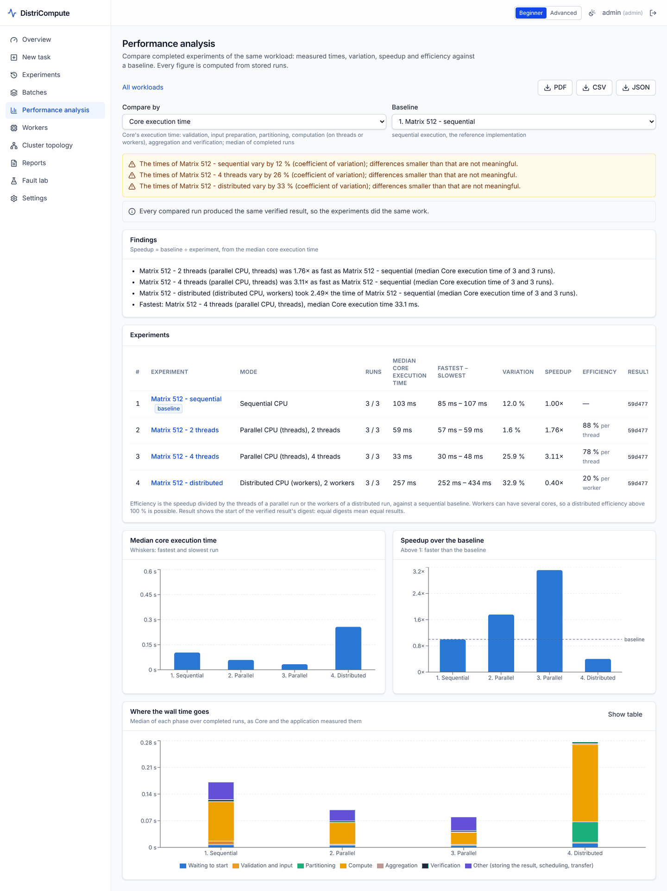

# Screenshots

Taken in Chromium (1440 × 900, light theme unless noted) from the packaged application in the standalone mode
([../standalone.md](../standalone.md)) on a 4-core Linux machine, after running through the API a benchmark batch
(512 × 512 matrix multiplication, sequential, 2 and 4 threads, distributed on the two local workers, three runs
each), three more experiments and a fault lab run. Every figure shown was measured; nothing is sample data.

| Page | Screenshot |
|---|---|
| Sign-in | [01-sign-in.png](01-sign-in.png) |
| Overview: experiments, workers, health, measured performance by mode, live activity | [02-overview.png](02-overview.png) |
| New task with the execution strategy advisor | [03-new-task-and-advisor.png](03-new-task-and-advisor.png) |
| Experiment, live monitor: partitions, attempts, assignment timeline per worker slot | [04-experiment-live-monitor.png](04-experiment-live-monitor.png) |
| Experiment, results: verification, digest, stored value | [05-experiment-results.png](05-experiment-results.png) |
| Experiment, metrics per run and statistics | [06-experiment-metrics.png](06-experiment-metrics.png) |
| Performance analysis: speedup, efficiency, variation, time breakdown, findings | [07-performance-analysis.png](07-performance-analysis.png) |
| Batch run in order | [08-batch.png](08-batch.png) |
| Experiment history | [09-experiment-history.png](09-experiment-history.png) |
| Workers | [10-workers.png](10-workers.png) |
| Cluster topology | [11-cluster-topology.png](11-cluster-topology.png) |
| Fault lab: a worker disconnect detected and recovered | [12-fault-lab.png](12-fault-lab.png) |
| Reports | [13-reports.png](13-reports.png) |
| Settings | [14-settings.png](14-settings.png) |
| Dark theme | [15-dark-theme-analysis.png](15-dark-theme-analysis.png) |
| Phone width (390 px) | [16-phone-width.png](16-phone-width.png) |

